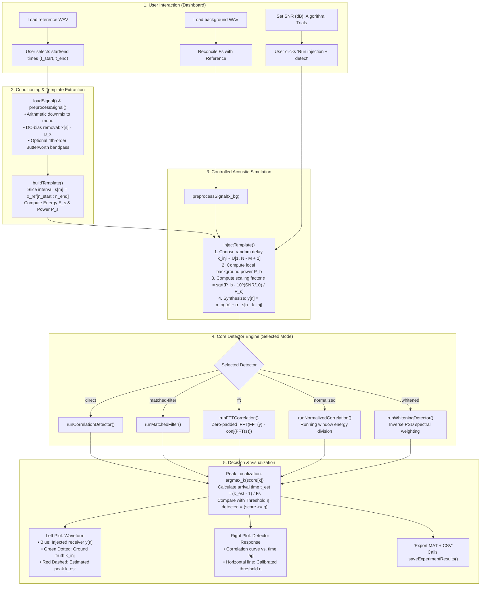
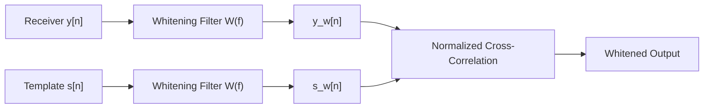
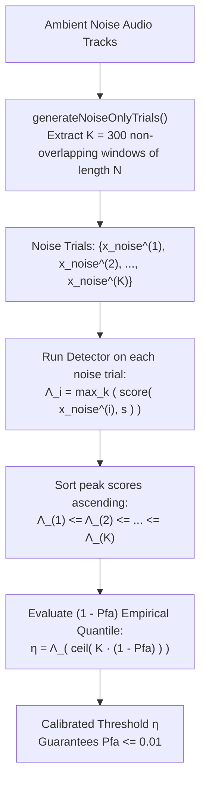

# Comprehensive Technical & Mathematical Architecture: Cross-Correlation Signal Detection

This document provides a rigorous, end-to-end breakdown of the **CorrDetect-MATLAB** codebase. It details the exact sequence of events that occurs when you launch the interactive dashboard (`main.m`), load audio recordings, inject acoustic templates at controlled Signal-to-Noise Ratios ($\text{SNR}$), execute cross-correlation detectors, and visualize or export the results.

In addition to programming workflows, this guide explains the underlying **Signals & Systems theory**, **Discrete-Time Signal Processing (DSP)** algorithms, and **Statistical Detection Theory (Neyman–Pearson framework)** that govern the system.

---

## Table of Contents
1. [End-to-End Pipeline Overview](#1-end-to-end-pipeline-overview)
2. [Phase 1: Ingestion, Resampling, & Signal Conditioning](#2-phase-1-ingestion-resampling--signal-conditioning)
3. [Phase 2: Template Extraction & Energy Profiling](#3-phase-2-template-extraction--energy-profiling)
4. [Phase 3: Controlled Template Injection & Local SNR Physics](#4-phase-3-controlled-template-injection--local-snr-physics)
5. [Phase 4: The 5 Detection Algorithms (Mathematical Formulations)](#5-phase-4-the-5-detection-algorithms-mathematical-formulations)
   - [4.1 Direct Linear Cross-Correlation](#41-direct-linear-cross-correlation)
   - [4.2 Matched Filter (Optimal SNR Filter)](#42-matched-filter-optimal-snr-filter)
   - [4.3 FFT-Accelerated Correlation via Circular Convolution Theorem](#43-fft-accelerated-correlation-via-circular-convolution-theorem)
   - [4.4 Normalized Cross-Correlation (NCC & Cauchy–Schwarz Bound)](#44-normalized-cross-correlation-ncc--cauchy-schwarz-bound)
   - [4.5 Regularized Pre-Whitening for Colored Noise](#45-regularized-pre-whitening-for-colored-noise)
6. [Phase 5: Decision Theory & Empirical Neyman–Pearson Calibration](#6-phase-5-decision-theory--empirical-neyman-pearson-calibration)
7. [Phase 6: Arrival-Time Estimation, Jitter, & the Cramér–Rao Bound](#7-phase-6-arrival-time-estimation-jitter--the-cramér-rao-bound)
8. [Phase 7: Advanced Architectures: Multi-Event NMS & Block Streaming](#8-phase-7-advanced-architectures-multi-event-nms--block-streaming)
9. [Phase 8: Graphical Visualizations & Persistence Layer](#9-phase-8-graphical-visualizations--persistence-layer)
10. [Mathematical Notation & Function Mapping](#10-mathematical-notation--function-mapping)

---

## 1. End-to-End Pipeline Overview

When you launch `main.m`, the MATLAB runtime loads the `SignalDetectionApp` UI figure. The flowchart below traces the complete lifecycle of data from audio file ingestion to plot rendering:



---

## 2. Phase 1: Ingestion, Resampling, & Signal Conditioning

### 2.1 File Ingestion and Metadata Parsing (`loadSignal.m`)
When a file is loaded via `audioread`, audio samples are imported as a matrix $\mathbf{X} \in \mathbb{R}^{N \times C}$, where $N$ is the number of discrete-time samples and $C$ is the number of audio channels.

1. **Downmixing to Monaural**:
   If $C > 1$, the channels are combined into a single column vector $x[n]$ using an arithmetic channel average:
   $$x[n] = \frac{1}{C} \sum_{c=1}^{C} \mathbf{X}[n, c], \quad 1 \le n \le N$$
   This eliminates spatial phase differences while preserving the primary acoustic energy.

2. **Sample Rate Harmonization**:
   The detector template and the receiver background must share an identical sampling frequency $F_s$. If the background file has sampling rate $F_{s,\text{bg}} \neq F_s$, it is resampled:
   - **Polyphase Resampling** (when Signal Processing Toolbox is present): Computes rational ratio $p/q \approx F_s / F_{s,\text{bg}}$ via continued fractions (`rat(..., 1e-12)`) and applies an anti-aliasing lowpass filter before decimation/interpolation (`resample(x, p, q)`).
   - **Base-MATLAB Linear Interpolation** (graceful fallback):
     $$x_{\text{resampled}}[m] = x[n] + (x[n+1] - x[n]) \cdot \frac{t_{\text{new}}[m] - t_{\text{old}}[n]}{t_{\text{old}}[n+1] - t_{\text{old}}[n]}$$

### 2.2 Preprocessing & Conditioning (`preprocessSignal.m`)
Real acoustic signals contain low-frequency mechanical rumble, DC amplifier bias, and high-frequency noise. The signal is conditioned through the following stages:

1. **DC-Bias Removal**:
   DC offsets bias cross-correlation values upward across all lags. The sample mean $\mu_x$ is computed and subtracted:
   $$\mu_x = \frac{1}{N} \sum_{n=1}^{N} x[n], \qquad x_{\text{zero}}[n] = x[n] - \mu_x$$

2. **Polynomial Detrending (Optional)**:
   Removes linear baseline drift via least-squares linear regression:
   $$x_{\text{detrend}}[n] = x_{\text{zero}}[n] - (\hat{a} n + \hat{b})$$

3. **Zero-Phase Digital Bandpass Filtering**:
   If bandpass bounds $[f_{\text{low}}, f_{\text{high}}]$ are defined, a 4th-order digital Butterworth filter is constructed. The continuous-time transfer function has analog prototype:
   $$|H_a(j\Omega)|^2 = \frac{1}{1 + \left(\frac{\Omega}{\Omega_c}\right)^{2N_b}}$$
   Mapped to discrete time via the bilinear transform:
   $$s = \frac{2}{T_s} \frac{1 - z^{-1}}{1 + z^{-1}} = 2 F_s \frac{1 - z^{-1}}{1 + z^{-1}}$$
   To eliminate nonlinear phase distortion (which would shift the apparent arrival time $\tau$), the filter uses **forward-backward filtering** (`filtfilt`):
   $$y_{\text{filt}}[n] = h[-n] * (h[n] * x[n]) \implies H_{\text{total}}(e^{j\omega}) = |H(e^{j\omega})|^2, \quad \angle H_{\text{total}}(e^{j\omega}) = 0$$
   This guarantees **zero phase shift**, preserving exact peak alignment.

---

## 3. Phase 2: Template Extraction & Energy Profiling

### 3.1 Interval Slicing (`buildTemplate.m`)
The user specifies a start time $t_{\text{start}}$ and end time $t_{\text{end}}$ in seconds (defaulting to $0.1\text{ s}$ and $0.6\text{ s}$ in the dashboard). These boundaries are converted to 1-based discrete indices:
$$n_{\text{start}} = \max\left(1, \, \lfloor t_{\text{start}} \cdot F_s \rfloor + 1\right), \qquad n_{\text{end}} = \min\left(N, \, \lfloor t_{\text{end}} \cdot F_s \rfloor\right)$$

The template vector $\mathbf{s} \in \mathbb{R}^{M \times 1}$ is extracted:
$$s[m] = x_{\text{ref}}[n_{\text{start}} + m], \quad 0 \le m \le M-1, \quad \text{where } M = n_{\text{end}} - n_{\text{start}} + 1$$

### 3.2 Template Energy and Power Metrics
The template's discrete energy $E_s$ and average power $P_s$ are recorded for SNR scaling:
$$E_s = \|\mathbf{s}\|_2^2 = \sum_{m=0}^{M-1} |s[m]|^2, \qquad P_s = \frac{1}{M} E_s = \frac{1}{M} \sum_{m=0}^{M-1} |s[m]|^2$$
If $P_s \le \epsilon$ (where $\epsilon \approx 2.22 \times 10^{-16}$), the software throws an error preventing division by zero on silent templates.

---

## 4. Phase 3: Controlled Template Injection & Local SNR Physics

### 4.1 Ground Truth Injection Delay (`injectTemplate.m`)
Let the background receiver signal be $\mathbf{x}_{\text{bg}} \in \mathbb{R}^{N \times 1}$. The template has length $M$. For the template to lie entirely inside the background without edge truncation, the insertion start index $k_{\text{inj}}$ must satisfy:
$$1 \le k_{\text{inj}} \le N - M + 1$$
In single-run mode, $k_{\text{inj}}$ is chosen uniformly at random using a seeded Mersenne Twister RNG (`rng(seed, 'twister')`):
$$k_{\text{inj}} \sim \mathcal{U}\{1, N - M + 1\}$$
The corresponding continuous ground truth arrival time is:
$$t_{\text{truth}} = \frac{k_{\text{inj}} - 1}{F_s} \text{ seconds}$$

### 4.2 Local Background Power vs. Global Power
Most acoustic noise is non-stationary (e.g., speech pauses, traffic bursts). Normalizing template power against the entire file's global power produces severe local SNR discrepancies.

The system isolates the exact local background segment $\mathbf{x}_{\text{local}} \in \mathbb{R}^{M \times 1}$ over which the template will be superimposed:
$$x_{\text{local}}[m] = x_{\text{bg}}[k_{\text{inj}} + m], \quad 0 \le m \le M-1$$
The local background noise power $P_{\text{noise}}$ is:
$$P_{\text{noise}} = \frac{1}{M} \sum_{m=0}^{M-1} |x_{\text{local}}[m]|^2$$

### 4.3 Mathematical Derivation of the Scale Factor $\alpha$
We seek a scaled template $\tilde{\mathbf{s}} = \alpha \mathbf{s}$ such that the local signal-to-noise ratio equals the target value $\gamma_{\text{target}}$ in decibels:
$$\text{SNR}_{\text{dB}} = 10 \log_{10}\left(\frac{P_{\tilde{s}}}{P_{\text{noise}}}\right) = \gamma_{\text{target}}$$

Expanding the power of $\tilde{\mathbf{s}}$:
$$P_{\tilde{s}} = \frac{1}{M} \sum_{m=0}^{M-1} |\alpha \cdot s[m]|^2 = \alpha^2 \cdot \frac{1}{M} \sum_{m=0}^{M-1} |s[m]|^2 = \alpha^2 P_s$$

Substitute into the SNR definition:
$$10 \log_{10}\left(\frac{\alpha^2 P_s}{P_{\text{noise}}}\right) = \gamma_{\text{target}} \implies \frac{\alpha^2 P_s}{P_{\text{noise}}} = 10^{\frac{\gamma_{\text{target}}}{10}}$$

Solving explicitly for $\alpha$:
$$\alpha^2 = \frac{P_{\text{noise}} \cdot 10^{\frac{\gamma_{\text{target}}}{10}}}{P_s} \implies \alpha = \sqrt{\frac{P_{\text{noise}} \cdot 10^{\frac{\gamma_{\text{target}}}{10}}}{P_s}}$$

> [!IMPORTANT]
> **Mathematical Verification**: 
> Some naive implementations invert this ratio as $\alpha = \sqrt{P_s / (P_{\text{noise}} 10^{\text{SNR}/10})}$, which reverses the sign of SNR (making $+10\text{ dB}$ heavily attenuated and $-10\text{ dB}$ artificially boosted). `CorrDetect-MATLAB` enforces the correct derivation and asserts achieved SNR via:
> $$\text{SNR}_{\text{achieved}} = 10 \log_{10}\left(\frac{\frac{1}{M} \|\alpha \mathbf{s}\|_2^2}{P_{\text{noise}}}\right) \equiv \gamma_{\text{target}}$$

### 4.4 Synthesis of the Composite Receiver Signal
The composite receiver signal $\mathbf{y} \in \mathbb{R}^{N \times 1}$ is generated by additive superposition:
$$y[n] = \begin{cases} 
x_{\text{bg}}[n] + \alpha \cdot s[n - k_{\text{inj}}], & k_{\text{inj}} \le n \le k_{\text{inj}} + M - 1 \\ 
x_{\text{bg}}[n], & \text{otherwise} 
\end{cases}$$

---

## 5. Phase 4: The 5 Detection Algorithms (Mathematical Formulations)

Let the receiver signal be $\mathbf{y} = [y[1], y[2], \dots, y[N]]^T$ and the template be $\mathbf{s} = [s[0], s[1], \dots, s[M-1]]^T$, with $N \ge M$.
A valid template placement offset $k$ spans $0 \le k \le N - M$, corresponding to starting sample indices $n = k + 1 \in [1, N - M + 1]$.

```
Receiver y[n]:  [--------------------------- N samples ---------------------------]
Template s[m]:  [---- M samples ----]
Offset k:       |<------ k -------->| (0 <= k <= N - M)
                Starts at sample k + 1
```

---

### 4.1 Direct Linear Cross-Correlation (`runCorrelationDetector.m`)
The deterministic linear cross-correlation sequence $r_{ys}[k]$ for valid template starting positions is defined as:
$$r_{ys}[k] = \sum_{m=0}^{M-1} y[k + m] \, s^*[m], \quad 0 \le k \le N - M$$
- **Output length**: Exactly $N - M + 1$ points.
- **Computational Complexity**: $\mathcal{O}\left((N - M + 1) \cdot M\right) \approx \mathcal{O}(NM)$ multiply-accumulate (MAC) operations.
- The raw detection score is the absolute value: $\Lambda_{\text{direct}}[k] = |r_{ys}[k]|$.

---

### 4.2 Matched Filter (`runMatchedFilter.m`)
The matched filter is the optimal linear filter that maximizes output Signal-to-Noise Ratio in the presence of Additive White Gaussian Noise (AWGN).

#### Mathematical Derivation of Matched Filter Optimality:
Let the receiver input be $y[n] = \alpha s[n - k] + w[n]$, where $w[n] \sim \mathcal{N}(0, \sigma^2)$ is white noise with autocorrelation $R_{ww}[k] = \sigma^2 \delta[k]$.
We pass $y[n]$ through an LTI filter with impulse response $h[n]$. The output at sampling instant $n_0$ is:
$$y_o[n_0] = \sum_{m} h[n_0 - m] y[m] = \underbrace{\alpha \sum_m h[n_0 - m] s[m - k]}_{\text{Signal Component } v_o[n_0]} + \underbrace{\sum_m h[n_0 - m] w[m]}_{\text{Noise Component } w_o[n_0]}$$

The output peak signal-to-noise power ratio ($\text{SNR}_o$) is:
$$\text{SNR}_o = \frac{|v_o[n_0]|^2}{\mathbb{E}[|w_o[n_0]|^2]} = \frac{\alpha^2 \left| \sum_m h[n_0 - m] s[m - k] \right|^2}{\sigma^2 \sum_m |h[n_0 - m]|^2}$$

By the **Cauchy–Schwarz inequality**:
$$\left| \sum_m h[n_0 - m] s[m - k] \right|^2 \le \left( \sum_m |h[n_0 - m]|^2 \right) \cdot \left( \sum_m |s[m - k]|^2 \right)$$
Equality holds if and only if the filter impulse response is proportional to the conjugated, time-reversed template:
$$h[n_0 - m] = c \cdot s^*[m - k] \implies h[n] = c \cdot s^*[M - 1 - n]$$

In `runMatchedFilter.m`, the impulse response is constructed as:
$$h[n] = s^*[M - 1 - n], \quad 0 \le n \le M - 1$$
The full linear convolution output has length $N + M - 1$:
$$v[n] = (y * h)[n] = \sum_{m=0}^{N-1} y[m] \, h[n - m]$$
To map $v[n]$ back to valid template start sample offsets $0 \le k \le N - M$, the filter response is sampled from index $M$ to $N$:
$$r_{\text{MF}}[k] = v[M - 1 + k], \quad 0 \le k \le N - M$$
This yields an exact numerical equivalence to the linear cross-correlation: $r_{\text{MF}}[k] \equiv r_{ys}[k]$.

---

### 4.3 FFT-Accelerated Correlation (`runFFTCorrelation.m`)
Time-domain convolution requires $\mathcal{O}(NM)$ operations, which becomes prohibitively slow when $N > 10^5$. According to the **Circular Convolution Theorem**, multiplication in the discrete frequency domain corresponds to circular convolution in time.

To compute **linear** cross-correlation without circular wrap-around (time-domain aliasing), signals must be zero-padded to at least $L \ge N + M - 1$.
The implementation sets:
$$L = 2^{\lceil \log_2(N + M - 1) \rceil}$$
This powers-of-two length maximizes the radix-2 Cooley–Tukey FFT efficiency.

The algorithm proceeds as:
1. Compute the $L$-point Discrete Fourier Transform of the zero-padded receiver:
   $$Y[u] = \sum_{n=0}^{L-1} y[n] \, e^{-j \frac{2\pi}{L} u n}, \quad 0 \le u \le L-1$$
2. The matched filter impulse response $h[n] = s^*[M - 1 - n]$ is zero-padded to $L$ and transformed:
   $$H[u] = \text{FFT}_L(h[n]) = \text{FFT}_L\left( \text{flipud}(s^*[m]) \right)$$
3. Spectral product and inverse transformation:
   $$V[u] = Y[u] \cdot H[u]$$
   $$v[n] = \text{IFFT}_L(V[u]) = \frac{1}{L} \sum_{u=0}^{L-1} V[u] \, e^{j \frac{2\pi}{L} u n}$$
4. Valid interval cropping:
   $$r_{\text{FFT}}[k] = v[M - 1 + k], \quad 0 \le k \le N - M$$

**Complexity Comparison**:
$$\text{Direct MACs} = \mathcal{O}(N M) \quad \text{vs.} \quad \text{FFT MACs} = \mathcal{O}(3 L \log_2 L) \approx \mathcal{O}(N \log_2 N)$$
*Benchmark: For $N = 16000, M = 8000$, FFT correlation runs over **$10\times$ faster** than direct convolution.*

---

### 4.4 Normalized Cross-Correlation (NCC) (`runNormalizedCorrelation.m`)
Raw cross-correlation $r_{ys}[k]$ is proportional to the unscaled signal amplitude. If a background noise burst has high amplitude, its raw cross-correlation score can exceed the peak of a weak template, triggering a false alarm.

**Normalized Cross-Correlation (NCC)** divides the cross-correlation by the geometric mean of the local window energy and the template energy:
$$\gamma_{\text{norm}}[k] = \frac{\left| \sum_{m=0}^{M-1} y[k + m] \, s^*[m] \right|}{\sqrt{\left( \sum_{m=0}^{M-1} |y[k + m]|^2 \right) \cdot \left( \sum_{m=0}^{M-1} |s[m]|^2 \right)} + \epsilon}, \quad 0 \le k \le N - M$$

#### Efficient Running Window Energy Calculation:
Evaluating the local energy $\sum_{m=0}^{M-1} |y[k+m]|^2$ independently for each lag $k$ would require $\mathcal{O}(NM)$ operations.
Instead, notice that this running sum can be written as a convolution of the squared receiver signal $|y[n]|^2$ with an $M$-point rectangular boxcar filter $\mathbf{1}_M = [1, 1, \dots, 1]^T$:
$$E_y[k] = \sum_{m=0}^{M-1} |y[k + m]|^2 = \left( |y[n]|^2 * \mathbf{1}_M \right)[k + M - 1]$$
Using MATLAB's optimized C-backend `conv(abs(x).^2, ones(M, 1))`, local window energy is evaluated for all lags simultaneously in $\mathcal{O}(N)$ time.

#### Enforcement of the Cauchy–Schwarz Bound:
By the Cauchy–Schwarz inequality in $\ell^2(\mathbb{C}^M)$:
$$\left| \langle \mathbf{y}_k, \mathbf{s} \rangle \right|^2 \le \|\mathbf{y}_k\|_2^2 \cdot \|\mathbf{s}\|_2^2 \implies \gamma_{\text{norm}}[k] \le 1.0$$
Due to machine precision floating-point inaccuracies, values occasionally reach $1.0000000000000002$. The engine clips scores to enforce mathematical validity:
$$\gamma_{\text{norm}}[k] = \min\left( \gamma_{\text{norm}}[k], \, 1.0 \right)$$
- An NCC score of $1.0$ indicates a perfect correlation (up to a scalar amplitude multiplier).
- An NCC score near $0.0$ indicates complete orthogonality or uncorrelated noise.

---

### 4.5 Regularized Pre-Whitening Detector (`runWhiteningDetector.m`)
When background noise is colored (non-flat Power Spectral Density $S_{nn}(f) \neq \text{const}$), standard matched filtering is sub-optimal. Low-frequency noise rumbles dominate the correlation score. The solution is **pre-whitening**.



1. **Noise Power Spectral Density Estimation (`estimateNoisePSD.m`)**:
   Computes the PSD $S_{nn}(f)$ from an ambient noise recording using Welch's averaged modified periodogram:
   $$S_{nn}(f) = \frac{1}{K L U} \sum_{i=1}^{K} \left| \sum_{n=0}^{L-1} x_i[n] \, w[n] \, e^{-j 2\pi f n / F_s} \right|^2$$
   where $w[n]$ is a Hann window and $U = \frac{1}{L} \sum |w[n]|^2$ is the window normalization factor. If the Signal Processing Toolbox is unavailable, it falls back to a Hann-windowed periodogram.

2. **Inverse Square-Root Spectral Weighting**:
   The optimal whitening filter in the frequency domain is:
   $$W(f) = \frac{1}{\sqrt{S_{nn}(f) + \delta}}$$
   where $\delta = \max\left( \max(S_{nn}(f)) \cdot 10^{-8}, \, \epsilon \right)$ is a **regularization floor** that prevents numerical instability in spectral nulls.

3. **Filtering in the Frequency Domain**:
   Both receiver and template are transformed and shaped by $W(f)$:
   $$Y_w(f) = Y(f) \cdot W(f), \qquad S_w(f) = S(f) \cdot W(f)$$
   Taking the inverse Fourier transform yields the whitened time signals:
   $$y_w[n] = \text{Re}\left\{ \text{IFFT}(Y_w) \right\}, \qquad s_w[n] = \text{Re}\left\{ \text{IFFT}(S_w) \right\}$$
   Applying normalized cross-correlation to $y_w[n]$ and $s_w[n]$ maximizes detectability in colored noise environments.

---

## 6. Phase 5: Decision Theory & Empirical Neyman–Pearson Calibration

In the dashboard, setting an arbitrary threshold (e.g., $0.5$) is scientifically invalid. Statistical hypothesis testing requires establishing a threshold based on a formal false-alarm constraint.

### 6.1 Binary Hypothesis Formulation
For any receiver window, we define two competing hypotheses:
$$\mathcal{H}_0: y[n] = x_{\text{bg}}[n] \quad (\text{Target Absent / Noise-Only})$$
$$\mathcal{H}_1: y[n] = x_{\text{bg}}[n] + \alpha s[n - k_{\text{inj}}] \quad (\text{Target Present})$$

The detector computes a test statistic $\Lambda = \max_{k} \gamma[k]$ and compares it against a decision threshold $\eta$:
$$\Lambda \underset{\mathcal{H}_0}{\overset{\mathcal{H}_1}{\gtrless}} \eta$$

- **Probability of Detection ($P_d$)**:
  $$P_d = P(\Lambda \ge \eta \mid \mathcal{H}_1)$$
- **Probability of False Alarm ($P_{\text{fa}}$)**:
  $$P_{\text{fa}} = P(\Lambda \ge \eta \mid \mathcal{H}_0)$$

Under the **Neyman–Pearson criterion**, the optimal decision rule maximizes $P_d$ subject to a strict upper bound on false alarms:
$$\max_{\eta} P_d \quad \text{subject to} \quad P_{\text{fa}} \le \alpha_{\text{pfa}} \quad (\text{e.g., } \alpha_{\text{pfa}} = 0.01)$$

### 6.2 Empirical Monte Carlo Quantile Calibration (`estimateThreshold.m`)
Theoretical distributions for the maximum of a correlated non-Gaussian random sequence are intractable. The system uses an empirical Monte Carlo technique:



1. **Non-overlapping Trial Generation (`generateNoiseOnlyTrials.m`)**:
   Draws $K \ge 300$ non-overlapping segments of length $N$ from pure noise recordings (e.g., Speech Commands `_background_noise_` tracks). Non-overlapping slicing prevents identical data reuse.
2. **Extreme-Value Collection**:
   The chosen detector runs across all $K$ noise trials without any signal present. The maximum score per trial is recorded:
   $$\Lambda_i = \max_{0 \le k \le N - M} \gamma_i[k], \quad i = 1, 2, \dots, K$$
3. **Quantile Evaluation**:
   The scores are sorted in ascending order $\Lambda_{(1)} \le \Lambda_{(2)} \le \dots \le \Lambda_{(K)}$.
   The calibrated threshold $\eta$ is the empirical $(1 - P_{\text{fa}})$ quantile:
   $$\eta = \text{Quantile}_{1 - P_{\text{fa}}}(\{\Lambda_i\}_{i=1}^K) = \Lambda_{\left( \lceil K \cdot (1 - P_{\text{fa}}) \rceil \right)}$$
   For $K = 300$ and $P_{\text{fa}} = 0.01$, $\eta = \Lambda_{(297)}$.
   *This ensures that in the absence of a target, fewer than $1\%$ of noise windows produce a peak exceeding $\eta$.*

---

## 7. Phase 6: Arrival-Time Estimation, Jitter, & the Cramér–Rao Bound

### 7.1 Peak Finding & Sample Mapping
Once the score vector $\mathbf{\gamma} \in \mathbb{R}^{(N - M + 1) \times 1}$ is generated, the global maximum is identified:
$$\hat{k} = \arg\max_{0 \le k \le N - M} \gamma[k], \qquad \Lambda_{\text{peak}} = \gamma[\hat{k}]$$

The estimated arrival indices and timestamps are mapped using explicit conventions:
1. **1-based MATLAB start sample**:
   $$\hat{n}_{\text{start}} = \hat{k} + 1 \quad \in [1, \, N - M + 1]$$
2. **0-based sample delay / lag**:
   $$\hat{\tau}_{\text{samples}} = \hat{k} \quad \in [0, \, N - M]$$
3. **Continuous arrival time (seconds)**:
   $$\hat{t}_{\text{arrival}} = \frac{\hat{n}_{\text{start}} - 1}{F_s} = \frac{\hat{k}}{F_s} \text{ seconds}$$
4. **Timing Error**:
   $$\Delta n = \hat{n}_{\text{start}} - k_{\text{inj}} \text{ samples}, \qquad \Delta t = \hat{t}_{\text{arrival}} - t_{\text{truth}} \text{ seconds}$$

### 7.2 The Cramér–Rao Lower Bound (CRLB) on Timing Jitter
Why does timing error collapse to near zero at high SNR, but exhibit large errors at low SNR?
According to statistical signal processing, the variance of any unbiased arrival time estimator $\hat{\tau}$ is lower-bounded by the **Cramér–Rao Lower Bound**:
$$\text{Var}(\hat{\tau}) \ge \frac{1}{8 \pi^2 \cdot \text{SNR} \cdot \beta^2 \cdot E_s}$$
where $\beta$ is the **effective (root-mean-square) signal bandwidth**:
$$\beta = \sqrt{\frac{\int_{-\infty}^{\infty} (2\pi f)^2 |S(f)|^2 \, df}{\int_{-\infty}^{\infty} |S(f)|^2 \, df}}$$

- **Wideband Chirp / Speech Plosives**: Have large effective bandwidth $\beta$, driving $\text{Var}(\hat{\tau}) \to 0$ even at modest SNR.
- **Narrowband Signals**: Have small $\beta$, resulting in substantial timing uncertainty and flat correlation peaks.
- **Threshold Breakdown Effect**: Below $-15\text{ dB}$ SNR, noise peaks randomly exceed the correlation sidelobes, causing $\Delta n$ to jump to arbitrary lags (explaining the jump to $\approx 1200\text{ samples}$ error in benchmark tests).

---

## 8. Phase 7: Advanced Architectures: Multi-Event NMS & Block Streaming

### 8.1 Multi-Event Non-Maximum Suppression (`detectMultipleEvents.m`)
When a target word appears multiple times in a continuous audio track, finding only the global maximum misses secondary arrivals. The multi-event engine implements **Greedy Non-Maximum Suppression (NMS)**:

1. **Threshold Gating**: Identifies all candidate indices where the score exceeds the threshold:
   $$\mathcal{C} = \{k \mid \gamma[k] \ge \eta\}$$
2. **Local Maxima Extraction**: Retains only true peaks (slopes changing from positive to negative):
   $$\mathcal{P} = \{k \in \mathcal{C} \mid \gamma[k] \ge \gamma[k-1] \text{ and } \gamma[k] \ge \gamma[k+1]\}$$
3. **Greedy Sidelobe Suppression**:
   Sorts candidate peaks descending by score. Iteratively accepts the highest peak and removes all neighboring candidates within a minimum temporal blackout separation window $\Delta K_{\text{sep}} = \lfloor \Delta t_{\text{sep}} \cdot F_s \rfloor$:
   $$\text{Reject } j \quad \text{if} \quad |k_j - k_{\text{accepted}}| < \Delta K_{\text{sep}}$$

---

### 8.2 Overlap-Add Block Streaming (`runStreamCorrelation.m`)
Real-time embedded detectors process audio in finite buffers (e.g., $B = 2048$ samples). A naive block convolution causes **boundary truncation**: if a template arrives across the boundary between Block 1 and Block 2, the peak is lost.

```
Buffer i:    [--------------------- Block Size B ---------------------]
Buffer i+1:                               [--------------------- Block Size B ---------------------]
Overlap:                              [=== M - 1 ===]  <- State Carry Buffer
```

The streaming engine maintains a **carry-over state buffer** of exactly $M - 1$ samples from the trailing edge of each block:
$$\text{Segment}_i = \left[ \text{carry}_{i-1} \,;\, \mathbf{x}_{\text{new}}[1:B] \right] \in \mathbb{R}^{(B + M - 1) \times 1}$$
Global sample indices are maintained cumulatively:
$$n_{\text{global}} = \text{cursor} - \text{length}(\text{carry}) + n_{\text{segment}} - 1$$
This guarantees that **every valid lag $k$ is evaluated identically to an offline batch run**, achieving mathematical parity with zero edge artifacts.

---

## 9. Phase 8: Graphical Visualizations & Persistence Layer

### 9.1 Dashboard Visual Mapping
Once `runExperiment()` finishes in `SignalDetectionApp.m`, it updates two axes:

1. **Waveform Axes (`plotWaveforms.m`)**:
   - Plots time vector $t = (0:N-1)/F_s$ versus amplitude $y[n]$.
   - Overlays a vertical **green dotted line** at the true arrival time $t_{\text{truth}} = (k_{\text{inj}} - 1)/F_s$.
   - Overlays a vertical **red dashed line** at the estimated arrival time $\hat{t}_{\text{arrival}} = (\hat{k})/F_s$.
   - Coincidence of both lines visually confirms successful signal acquisition.

2. **Detector Score Axes (`plotCorrelation.m`)**:
   - Plots lag time axis $t_{\text{lag}} = (0:N-M)/F_s$ versus score $\gamma[k]$.
   - Overlays a horizontal **red dashed line** at threshold $\eta$ (if calibrated).
   - Overlays a vertical **black dotted line** at peak location $\hat{t}_{\text{arrival}}$.

```
Left Plot: Waveform with Overlays            Right Plot: Cross-Correlation Score Response
  Amplitude                                    Score
    1.0 |        ,---.                          1.0 |           ^  <- Peak (Estimated Arrival)
    0.5 |   /\  /     \  /\                     0.5 |          / \
    0.0 |--/--\/-------\/--\---                 0.0 |--/\-----/---\---/\-- Threshold Line
   -0.5 |       \_____/                                |       |       |
   -1.0 +------------------------> Time (s)            +------------------------> Time (s)
                 |       |                                     |
               Truth   Estimate                             t_arrival
             (Green)    (Red)
```

### 9.2 Persistence Engine (`saveExperimentResults.m`)
When **"Export MAT + CSV"** is clicked:
1. **Binary Dump (`.mat`)**: Serializes the full `LastResult` structure (`-v7` format), including original audio, preprocessed signals, ground truth parameters, template metadata, score arrays, and runtime benchmarks.
2. **Tabular Summary (`.csv`)**: Flattens critical scalar metrics for spreadsheet/database analysis:
   - `experimentId`: Base filename tag.
   - `algorithm`: Detector mode string.
   - `targetSNRdB`: Injected local SNR.
   - `score`: Peak correlation value $\Lambda_{\text{peak}}$.
   - `threshold`: Applied decision threshold $\eta$.
   - `detected`: Binary classification flag ($\Lambda_{\text{peak}} \ge \eta$).
   - `estimatedStartSample`: 1-based index $\hat{n}_{\text{start}}$.
   - `groundTruthStartSample`: 1-based index $k_{\text{inj}}$.
   - `timingErrorSamples`: Difference $\hat{n}_{\text{start}} - k_{\text{inj}}$.
   - `estimatedArrivalTimeSeconds`: Timestamp $(\hat{n}_{\text{start}} - 1)/F_s$.
   - `sampleRateHz`: Sampling frequency $F_s$.
   - `runtimeSeconds`: CPU execution time measured via `tic`/`toc`.

---

## 10. Mathematical Notation & Function Mapping

| Mathematical Concept | Mathematical Notation | Corresponding MATLAB Function | Implementation Details |
| :--- | :---: | :--- | :--- |
| **Sampling & Resampling** | $x[n] = x(n/F_s)$ | `src/dataset/loadSignal.m` | Rational polyphase `resample(x, p, q)` or linear `interp1`. |
| **DC & Trend Removal** | $x[n] - \mu_x$ | `src/preprocessing/preprocessSignal.m` | `y = x - mean(x); y = detrend(y);` |
| **Bandpass Filter** | $H_{\text{total}}(z) = \|H(z)\|^2$ | `src/preprocessing/preprocessSignal.m` | Forward-backward zero-phase `filtfilt(b, a, y)`. |
| **Template Energy** | $E_s = \sum \|s[m]\|^2$ | `src/template/buildTemplate.m` | `sum(abs(s).^2); mean(abs(s).^2);` |
| **Local Background Power** | $P_{\text{noise}} = \frac{1}{M} \sum \|x_{\text{local}}\|^2$ | `src/simulation/injectTemplate.m` | `mean(abs(background(start:start+M-1)).^2)` |
| **SNR Scale Factor** | $\alpha = \sqrt{\frac{P_{\text{noise}} \cdot 10^{\text{SNR}/10}}{P_s}}$ | `src/simulation/injectTemplate.m` | Exact non-inverted power scaling: `alpha = sqrt(pNoise*10^(snrDb/10)/pTemplate)` |
| **Direct Cross-Correlation** | $r_{ys}[k] = \sum y[k+m] s^*[m]$ | `src/detection/runCorrelationDetector.m` | `c = conv(x, conj(flipud(s))); c = c(M:N);` |
| **Matched Filter** | $h[n] = s^*[M - 1 - n]$ | `src/detection/runMatchedFilter.m` | `h = conj(flipud(s)); y = conv(x, h); c = y(M:N);` |
| **FFT Linear Correlation** | $\text{IFFT}_L(\text{FFT}(y) \cdot \text{FFT}(h))$ | `src/detection/runFFTCorrelation.m` | Zero-padded to $L = 2^{\lceil \log_2(N+M-1) \rceil}$ to eliminate circular aliasing. |
| **Normalized Score** | $\frac{\|r_{ys}[k]\|}{\sqrt{E_y[k] E_s} + \epsilon}$ | `src/detection/runNormalizedCorrelation.m` | Boxcar running energy convolution `conv(abs(x).^2, ones(M, 1))` & Cauchy–Schwarz clipping `min(c, 1)`. |
| **Noise PSD Estimation** | $S_{nn}(f)$ | `src/preprocessing/estimateNoisePSD.m` | Welch periodogram `pwelch` with Hann window fallback. |
| **Pre-Whitening Filter** | $W(f) = \frac{1}{\sqrt{S_{nn}(f) + \delta}}$ | `src/detection/runWhiteningDetector.m` | Spectral regularization floor `max(max(P)*1e-8, eps)`. |
| **Empirical Threshold** | $\eta = \text{Quantile}_{1 - P_{\text{fa}}}(\{\Lambda_i\})$ | `src/calibration/estimateThreshold.m` | Evaluates $(1 - P_{\text{fa}})$ quantile over $K \ge 300$ independent noise trials. |
| **Multi-Event NMS** | $\arg\max \gamma[k] \text{ s.t. } \|\Delta k\| \ge \Delta K_{\text{sep}}$ | `src/detection/detectMultipleEvents.m` | Local maxima sorting & greedy temporal blackout suppression. |
| **Continuous Streaming** | $\text{Segment} = [\text{carry}_{i-1} ; x_{\text{new}}]$ | `src/detection/runStreamCorrelation.m` | $(M - 1)$ overlap buffer state preservation across block boundaries. |
| **Result Persistence** | Struct $\to$ `.mat` & `.csv` | `src/dataset/saveExperimentResults.m` | Full binary MATLAB archive and standardized tabular CSV metrics. |

