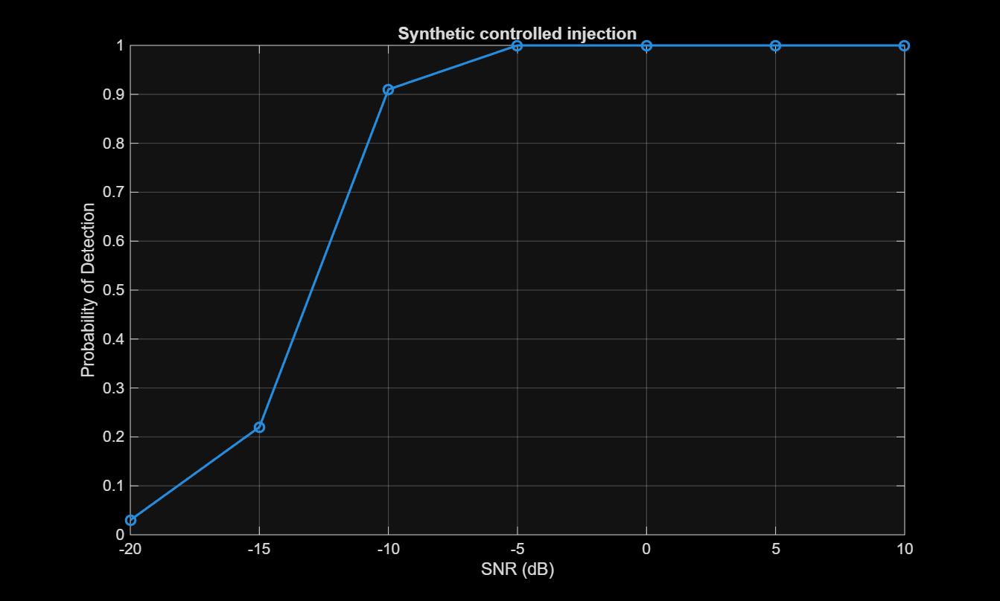
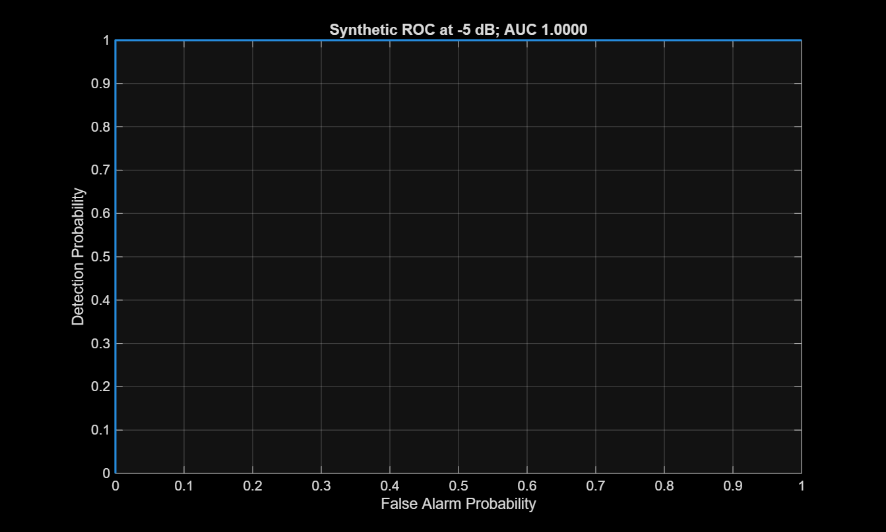
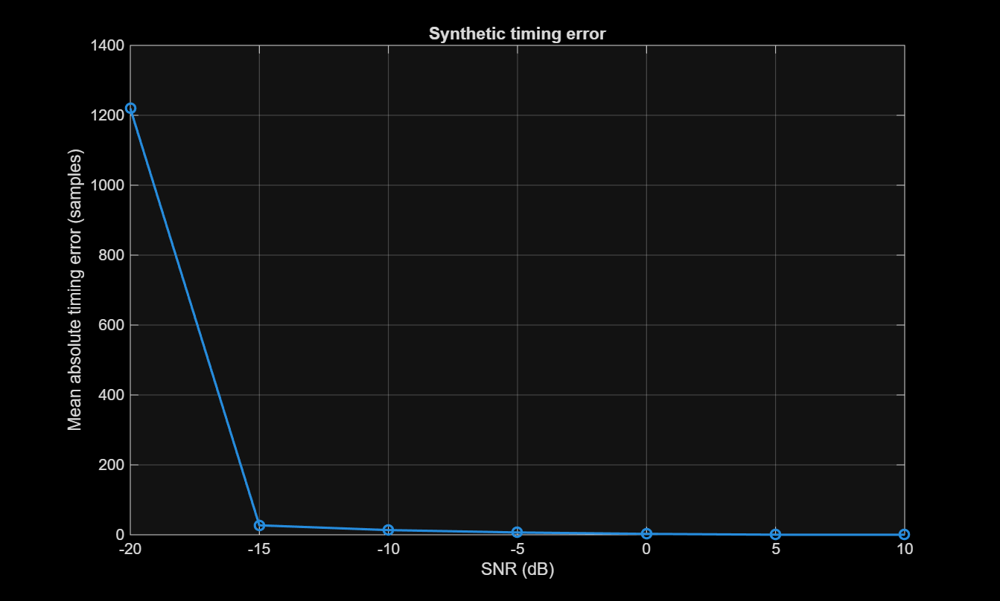
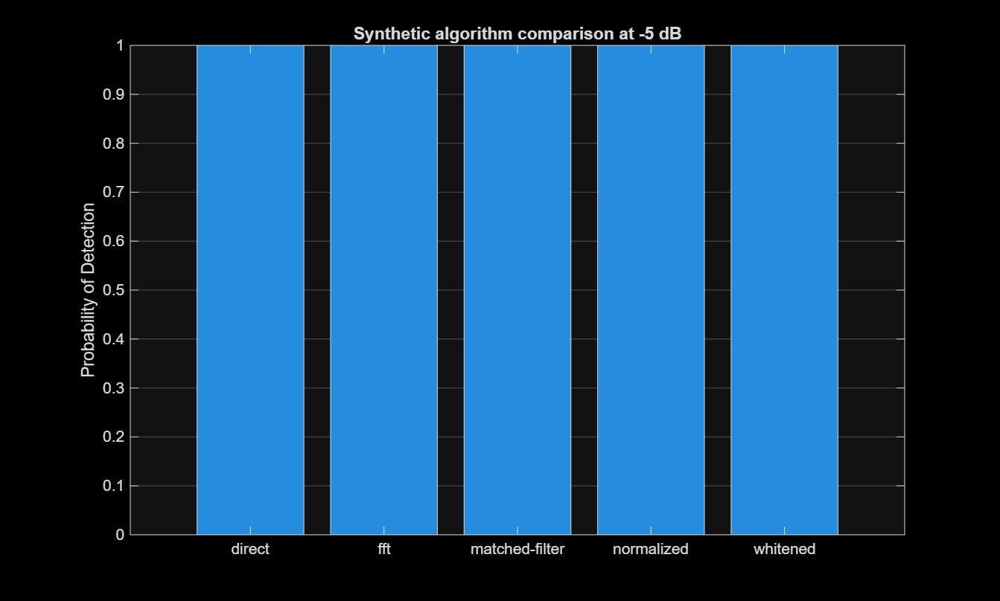
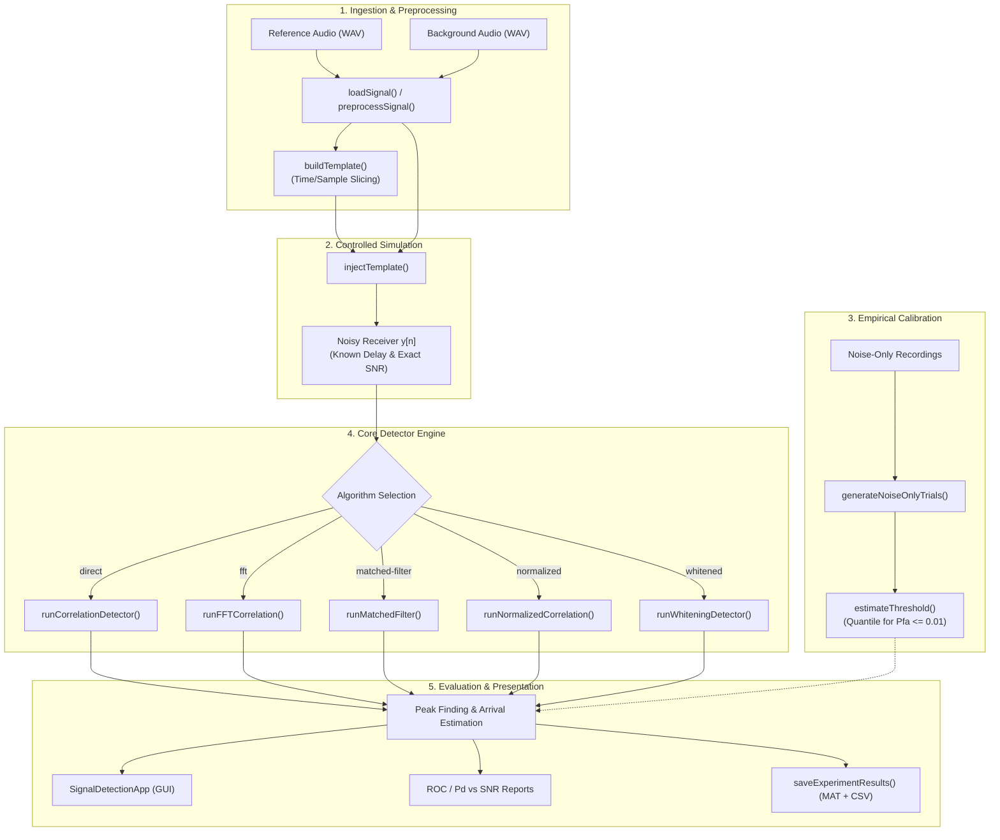

# CorrDetect-MATLAB

**A modular MATLAB framework for acoustic signal detection, matched filtering, and arrival-time estimation with empirical Neyman–Pearson threshold calibration and interactive visualization.**

[](https://www.mathworks.com/products/matlab.html)
[](tests/runAllTests.m)
[-orange.svg)](requirements.md)
[](scripts/downloadDataset.m)
[](#license)

---

## Overview

In acoustic monitoring, sonar, radar, and keyword spotting, detecting weak target signatures buried in ambient noise requires precise waveform alignment and statistically grounded thresholding. Arbitrary detection thresholds frequently produce unacceptable false-alarm rates ($P_{\text{fa}}$) or miss low-amplitude events.

**CorrDetect-MATLAB** provides a complete, mathematically verified engineering pipeline to:
1. **Extract and condition** reference signal templates from raw audio recordings.
2. **Inject templates** into background receiver channels at calibrated signal-to-noise ratios ($\text{SNR}_{\text{dB}}$) and deterministic arrival delays.
3. **Detect and localize arrival times** using five core detection algorithms: direct cross-correlation, FFT-accelerated correlation, matched filtering, normalized cross-correlation, and pre-whitening.
4. **Calibrate decision thresholds** empirically using Monte Carlo trials on held-out noise-only data under the Neyman–Pearson criterion ($P_{\text{fa}} \le 1\%$).
5. **Inspect and evaluate** detection metrics through an interactive App Designer GUI, automated test suites, and batch ROC/timing benchmark reports.

---

## Key Features

- **5 Detection Algorithms**:
  - **Normalized Cross-Correlation (`normalized`)**: Amplitude-invariant scoring bounded strictly in $[0, 1]$ via the Cauchy–Schwarz inequality, robust against receiver volume swings.
  - **FFT-Accelerated Correlation (`fft`)**: Zero-padded linear correlation computed in $O(N \log N)$ time, preventing circular boundary wrap-around.
  - **Matched Filtering (`matched-filter`)**: Optimal linear filtering for additive white Gaussian noise with exact valid-window start sample mapping.
  - **Direct Time-Domain Correlation (`direct`)**: Direct convolution/correlation reference baseline.
  - **Regularized Spectral Whitening (`whitened`)**: Inverts background noise Power Spectral Density (PSD) to maximize output SNR in colored-noise environments.
- **Empirical Neyman–Pearson Threshold Calibration**:
  - Automatically draws non-overlapping windows from noise-only recordings to compute quantile-based detection thresholds for specified false-alarm rates (e.g., $P_{\text{fa}} = 0.01$).
- **Sample-Accurate Ground Truth & Alignment**:
  - Enforces 1-based MATLAB start sample indexing and 0-based time lag mapping.
  - Uses mathematically consistent SNR scaling: $\alpha = \sqrt{\frac{P_{\text{noise}} \cdot 10^{\text{SNR}_{\text{dB}}/10}}{P_{\text{template}}}}$.
- **Multi-Event & Streaming Detection**:
  - **`detectMultipleEvents`**: Identifies multiple target occurrences in a continuous stream with greedy non-maximum suppression.
  - **`runStreamCorrelation`**: Processes continuous buffers using overlap-add logic without boundary truncation artifacts.
- **Interactive MATLAB Dashboard**:
  - Visual app to load reference/background WAV files, configure SNR and trials, inspect waveforms with true vs. estimated arrival markers, and export to `.mat` and `.csv`.
- **Zero Mandatory External Dependencies**:
  - Runs on base MATLAB. Automatically utilizes Signal Processing Toolbox functions (`butter`, `filtfilt`, `pwelch`, `resample`) when available, and falls back gracefully to base MATLAB equivalents (windowed periodograms, interpolation) when absent.

---

## Performance & Benchmark Results

The following performance figures are generated directly from the reproducible 100-trial Monte Carlo benchmark (`runSyntheticDemo(1729, 100)`):

| Detection Probability ($P_d$) vs. SNR | Receiver Operating Characteristic (ROC) |
| :---: | :---: |
|  |  |
| *Clear detection threshold transition between $-15\text{ dB}$ and $-5\text{ dB}$.* | *Area Under Curve (AUC) = 1.0000 at $-5\text{ dB}$ SNR.* |

| Timing Error vs. SNR | Algorithm Pd Comparison |
| :---: | :---: |
|  |  |
| *Sample arrival error collapses to $< 7$ samples above $-5\text{ dB}$.* | *All five algorithms achieve $100\%$ detection at $-5\text{ dB}$ SNR.* |

### Measured Detection & Timing Metrics (`results/metrics/synthetic_demo_metrics.csv`)
| Target SNR | Detection Rate ($P_d$) | Miss Rate ($P_m$) | Mean Timing Error (Samples) | Held-Out Noise $P_{\text{fa}}$ |
| :---: | :---: | :---: | :---: | :---: |
| **$-20\text{ dB}$** | $3.0\%$ | $97.0\%$ | $1219.67$ | $0.01$ |
| **$-15\text{ dB}$** | $22.0\%$ | $78.0\%$ | $27.09$ | $0.01$ |
| **$-10\text{ dB}$** | $91.0\%$ | $9.0\%$ | $13.48$ | $0.01$ |
| **$-5\text{ dB}$** | **$100.0\%$** | **$0.0\%$** | **$6.67$** | **$0.01$** |
| **$0\text{ dB}$** | $100.0\%$ | $0.0\%$ | $2.60$ | $0.01$ |
| **$+5\text{ dB}$** | $100.0\%$ | $0.0\%$ | $0.26$ | $0.01$ |
| **$+10\text{ dB}$** | $100.0\%$ | $0.0\%$ | $0.13$ | $0.01$ |

### Algorithm Runtime Benchmark (`results/metrics/synthetic_algorithm_comparison.csv`)
| Algorithm | $P_d$ (at $-5\text{ dB}$) | Empirical $P_{\text{fa}}$ | Mean Timing Error | Mean Runtime / Call |
| :--- | :---: | :---: | :---: | :---: |
| **Matched Filter** | $1.00$ | $0.00$ | $5.38\text{ samples}$ | **$0.243\text{ ms}$** |
| **Normalized Cross-Corr** | $1.00$ | $0.01$ | $7.34\text{ samples}$ | **$0.327\text{ ms}$** |
| **FFT Correlation** | $1.00$ | $0.00$ | $6.88\text{ samples}$ | **$0.362\text{ ms}$** |
| **Direct Cross-Corr** | $1.00$ | $0.00$ | $5.83\text{ samples}$ | **$0.702\text{ ms}$** |
| **Whitened Correlation** | $1.00$ | $0.00$ | $11.97\text{ samples}$ | **$1.607\text{ ms}$** |

---

## System Architecture



---

## Project Structure

```
crosscorr_detector/
├── app/
│   └── SignalDetectionApp.m       # Interactive MATLAB App Designer UI dashboard
├── config/
│   └── experimentConfig.m         # Default parameters (SNR levels, seed, trials)
├── data/
│   ├── manifests/                 # Audio metadata manifests (speech_commands_manifest.csv)
│   ├── processed/                 # Generated audio outputs and latest experiment MAT files
│   ├── raw/                       # Source audio files and speech commands archives
│   └── templates/                 # Serialized reference template MAT files
├── docs/
│   ├── architecture.md            # Structural documentation and component isolation
│   ├── feature_status.md          # Implementation audit and feature status
│   ├── implementation_guide.md    # API usage and workflow instructions
│   ├── mathematical_foundation.md # Mathematical proofs, SNR equations, and conventions
│   └── testing_report.md          # Verification status and numerical validation notes
├── results/
│   ├── figures/                   # Generated PNG plots (ROC, Pd vs SNR, timing error)
│   └── metrics/                   # Output CSV metrics and evaluation summaries
├── scripts/
│   ├── downloadDataset.m          # Secure downloader for Speech Commands v0.02
│   ├── runBaselineExperiment.m    # Complete reproducible WAV-to-detection workflow
│   └── runSyntheticDemo.m         # Synthetic chirp-in-noise benchmark suite
├── src/
│   ├── calibration/
│   │   └── estimateThreshold.m    # Neyman–Pearson noise quantile estimator
│   ├── dataset/
│   │   ├── createDatasetManifest.m# WAV dataset inspection and manifest generation
│   │   ├── inspectDataset.m       # Audio header metadata reader
│   │   ├── loadSignal.m           # Robust audio import, downmixing, and resampling
│   │   └── saveExperimentResults.m# Structured MAT and CSV experiment persistence
│   ├── detection/
│   │   ├── detectMultipleEvents.m # Multi-peak threshold crossing with peak suppression
│   │   ├── runCorrelationDetector.m # Direct time-domain cross-correlation
│   │   ├── runFFTCorrelation.m    # Zero-padded linear FFT correlation
│   │   ├── runMatchedFilter.m     # Matched filter implementation
│   │   ├── runNormalizedCorrelation.m # Cauchy-Schwarz normalized correlation
│   │   ├── runStreamCorrelation.m # Overlap-add block/streaming correlation
│   │   └── runWhiteningDetector.m # Regularized frequency-domain whitening
│   ├── evaluation/
│   │   ├── benchmarkAlgorithms.m  # Execution runtime and memory benchmarking
│   │   ├── evaluateDetector.m     # Monte Carlo Pd and timing error evaluator
│   │   ├── evaluateNoiseOnly.m    # Held-out false alarm evaluator
│   │   └── generateROC.m          # Empirical ROC curve and AUC calculator
│   ├── preprocessing/
│   │   ├── estimateNoisePSD.m     # Welch PSD with periodogram fallback
│   │   └── preprocessSignal.m     # Mean removal, detrending, and bandpass filtering
│   ├── simulation/
│   │   ├── generateNoiseOnlyTrials.m # Non-overlapping noise slice generator
│   │   └── injectTemplate.m       # Local background power-scaled injection
│   ├── template/
│   │   ├── buildTemplate.m        # Reference template interval extraction
│   │   └── saveTemplate.m         # Lossless template MAT serialization
│   └── visualization/
│       ├── plotCorrelation.m      # Correlation score vs. time lag plotter
│       └── plotWaveforms.m        # Time-domain waveform plotter
├── tests/
│   └── runAllTests.m              # 10 deterministic core unit and math tests
├── main.m                         # Dashboard launch entry point
├── requirements.md                # MATLAB runtime and toolbox compatibility specifications
└── .gitignore                     # Git rules protecting against 2GB+ raw audio uploads
```

---

## Prerequisites

- **MATLAB Runtime**: MATLAB R2019b or newer (tested on R2026b).
- **Core Environment**: Base MATLAB (`audioread`, `audiowrite`, `conv`, `fft`, `ifft`, `uifigure`).
- **Optional Toolboxes**:
  - *Signal Processing Toolbox*: Used for `butter`, `filtfilt`, `pwelch`, and `resample`. If not installed, the codebase falls back cleanly to built-in linear interpolation and windowed periodograms.
- **External Dependencies**: None. (No Python, Statistics Toolbox, or C/MEX dependencies required).

---

## Installation & Setup

1. **Clone the Repository**:
   ```bash
   git clone https://github.com/<your-username>/CorrDetect-MATLAB.git
   cd CorrDetect-MATLAB
   ```

2. **Open MATLAB and Set Workspace**:
   In the MATLAB Command Window:
   ```matlab
   cd('E:\Matlab Codes\Lab Project\crosscorr_detector')
   addpath(genpath('src'))
   addpath('app')
   addpath('scripts')
   addpath('tests')
   addpath('config')
   ```

---

## Quick Start Guide

### 1. Launch the Interactive Dashboard
To launch the interactive GUI:
```matlab
main
```
1. Click **Load reference WAV** (e.g., select a keyword audio file from `data/raw/speech_commands_v0.02/yes/`) and confirm the template start/end time.
2. Click **Load background WAV** (e.g., ambient sound from `_background_noise_/` or speech from `no/`).
3. Set **SNR dB** (e.g., `-5`) and choose an **Algorithm** (e.g., `normalized`).
4. Click **Run injection + detect**.
   - **Left Axes**: Displays the injected receiver waveform with **Green dotted line** (True arrival) and **Red dashed line** (Estimated arrival).
   - **Right Axes**: Displays the cross-correlation score response showing the detection peak.
5. Click **Export MAT + CSV** to save results into `results/metrics/`.

---

### 2. Run the Synthetic Benchmark Suite
To generate the full ROC curves, detection rates across SNR levels, and algorithm comparisons without downloading any external datasets:
```matlab
report = runSyntheticDemo(1729, 100);
```
Outputs are written to:
- `results/figures/synthetic_*.png`
- `results/metrics/synthetic_*.csv`
- `results/metrics/synthetic_demo.mat`

---

### 3. Run Real Audio Injection with Noise Calibration
To run an automated controlled injection on speech commands audio with empirical noise calibration:
```matlab
root = pwd;
speechDir = fullfile(root, 'data', 'raw', 'speech_commands_v0.02');

% Automatically pick the first available audio recording from each word folder
yesFiles = dir(fullfile(speechDir, 'yes', '*.wav'));
noFiles  = dir(fullfile(speechDir, 'no', '*.wav'));
refFile  = fullfile(yesFiles(1).folder, yesFiles(1).name);
bgFile   = fullfile(noFiles(1).folder,  noFiles(1).name);

% Runs injection at -5 dB SNR with empirical calibration
result = runBaselineExperiment(refFile, bgFile, -5, 1729);

disp(result.detection);
fprintf('Achieved Timing Error: %+d samples\n', result.timingErrorSamples);
```

---

## Core API & Programmatic Usage

### 1. Template Extraction & Controlled Injection
```matlab
% Automatically pick files from dataset or specify a specific WAV path
yesFiles = dir('data/raw/speech_commands_v0.02/yes/*.wav');
noFiles  = dir('data/raw/speech_commands_v0.02/no/*.wav');

% Load reference and isolate the target word template
[refAudio, Fs] = loadSignal(fullfile(yesFiles(1).folder, yesFiles(1).name));
[template, tMeta] = buildTemplate(refAudio, Fs, round(0.15*numel(refAudio)), round(0.85*numel(refAudio)));

% Load background receiver audio
[bgAudio, Fs] = loadSignal(fullfile(noFiles(1).folder, noFiles(1).name), Fs);
bgPreprocessed = preprocessSignal(bgAudio, Fs, struct('removeMean', true));
[bgAudio, Fs] = loadSignal('data/raw/speech_commands_v0.02/no/0165e0e8_nohash_0.wav', Fs);
bgPreprocessed = preprocessSignal(bgAudio, Fs, struct('removeMean', true));

% Inject template at -5 dB local SNR with random seed 1729
[injectedReceiver, truth, snrMeta] = injectTemplate(bgPreprocessed, template, Fs, -5, 1729);
```

### 2. Neyman–Pearson Threshold Calibration
```matlab
% Load independent noise-only background files
[noise1, Fs] = loadSignal('data/raw/speech_commands_v0.02/_background_noise_/white_noise.wav', Fs);
[noise2, Fs] = loadSignal('data/raw/speech_commands_v0.02/_background_noise_/doing_the_dishes.wav', Fs);

% Extract 300 non-overlapping windows matching receiver duration
noiseTrials = generateNoiseOnlyTrials({noise1, noise2}, numel(injectedReceiver), 300, 1729);

% Calibrate threshold for 1% false alarm probability (Pfa = 0.01)
cal = estimateThreshold(noiseTrials, template, Fs, 0.01, 'normalized');
fprintf('Calibrated Threshold: %.4f\n', cal.threshold);
```

### 3. Detection & Arrival Estimation
```matlab
% Run normalized cross-correlation
det = runNormalizedCorrelation(injectedReceiver, template, Fs, cal.threshold);

if det.detected
    fprintf('Signal Detected at %.4f seconds (Sample %d)\n', ...
        det.estimatedArrivalTime, det.estimatedStartSample);
    fprintf('Timing Error: %d samples\n', det.estimatedStartSample - truth.startSample);
else
    disp('Signal not detected (score fell below calibrated threshold).');
end
```

### 4. Multi-Event Peak Detection
```matlab
% Suppress neighboring sidelobes within 0.25 seconds of each peak
minSeparationSamples = round(0.25 * Fs);
events = detectMultipleEvents(det, cal.threshold, minSeparationSamples);

for i = 1:numel(events)
    fprintf('Event %d: Arrival %.3f s | Score: %.3f\n', i, events(i).arrivalTimeSeconds, events(i).score);
end
```

---

## Testing & Verification

The deterministic validation suite validates exact mathematical alignments, scale factors, and edge conditions:

```matlab
addpath('tests')
results = runAllTests();
```

### Automated Unit Test Roster (`tests/runAllTests.m`)
| Test Routine | Description | Status |
| :--- | :--- | :---: |
| `testLagConvention` | Confirms 1-based start sample and 0-based time lag mapping. | `PASS` |
| `testNoiseFreeDetection` | Verifies exact timing localization on ideal signals. | `PASS` |
| `testSNRScaling` | Verifies achieved vs. requested SNR via local background power scaling. | `PASS` |
| `testFFTCorrelation` | Validates numerical equality between direct, FFT, and matched filter. | `PASS` |
| `testNormalizedCorrelation` | Asserts score Cauchy–Schwarz bound $[0, 1]$ and finite scores on zero energy. | `PASS` |
| `testThresholdCalibration` | Verifies finite threshold estimation over Monte Carlo trials. | `PASS` |
| `testNoiseOnlyPfa` | Validates held-out false alarm probability satisfies $P_{\text{fa}} \le 0.12$ ($N=200$). | `PASS` |
| `testMultipleEvents` | Verifies greedy non-maximum suppression for recurring events. | `PASS` |
| `testReproducibility` | Asserts bit-identical synthetic signals given identical random seeds. | `PASS` |
| `testBlockBoundary` | Verifies continuous streaming correlation matches full batch processing. | `PASS` |

Test results are logged to `results/metrics/test_results.csv`.

---

## Dataset Acquisition

To download the full Google Speech Commands v0.02 dataset (~2.4 GB):
```matlab
addpath('scripts')
downloadDataset
```
- Downloads official archives from Google Cloud Storage mirror with TLS certificate verification.
- Extracts training and official test splits into `data/raw/speech_commands_v0.02/`.
- Generates a full metadata catalog at `data/manifests/speech_commands_manifest.csv`.

---

## Troubleshooting

- **`Undefined function or variable 'loadSignal'`**:
  - Run `addpath(genpath('src'))` from the project root to ensure all submodules are on the MATLAB search path.
- **`Background must be longer than the selected template`**:
  - Receiver background audio must have more samples than the template. Trim the template start/end time in `buildTemplate` or load a longer background WAV.
- **Threshold shows `Inf` / Uncalibrated in Dashboard**:
  - A threshold defaults to `Inf` unless calibrated on independent noise trials. Run `runBaselineExperiment` or provide a pre-calibrated threshold to evaluate binary detection decisions.
- **Large Dataset Pushes Blocked by Git**:
  - Ensure `.gitignore` is present in the repository root before committing. Raw audio files under `data/raw/speech_commands_v0.02/` exceed GitHub's 100 MB file limit and must remain untracked.

---

## Contributing

1. Fork the repository on GitHub.
2. Create a feature branch:
   ```bash
   git checkout -b feature/improved-whitening
   ```
3. Ensure all tests pass:
   ```matlab
   addpath('tests'); runAllTests();
   ```
4. Verify code formatting and linting using MATLAB Code Analyzer:
   ```matlab
   checkcode('src/detection/runNormalizedCorrelation.m')
   ```
5. Commit your changes and submit a Pull Request.

---

## License

This repository does not currently include an open-source license file. Consult the repository maintainers for permissions regarding distribution, modification, or commercial use.

Speech audio from the **Google Speech Commands v0.02** dataset is governed by its original creative commons and release terms. Consult the dataset documentation for terms of use.
